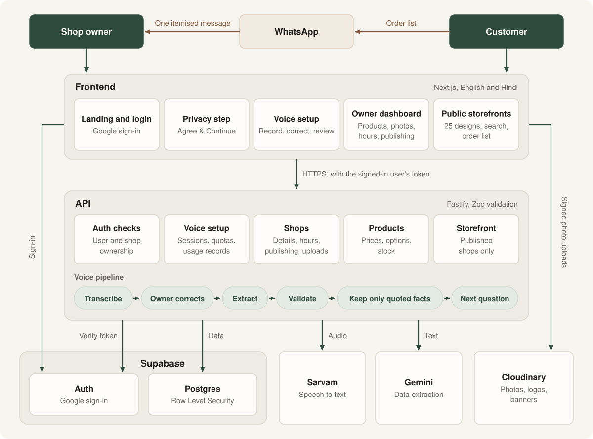

# VoiceCart AI

VoiceCart builds a website for a small shop from a spoken description.

A shop owner talks about their shop in Hindi or English: what they sell, their prices, when they're open. VoiceCart turns that into a storefront customers can browse on their phones and order from over WhatsApp. It's aimed at independent grocery, bakery, clothing and electronics shops in India.

The AI only ever produces data. It never writes the website. Storefronts are rendered from fixed templates, and the owner confirms every detail before it's saved.

## What it does

**Shop owners can:**

- Set up a shop by speaking or typing, in Hindi or English
- Answer follow-up questions about anything that's missing
- Choose from 25 designs, five for each shop type
- Sell with fixed prices, price ranges, "starting at" prices, or per-size options
- Add flavours, colours and other choices that don't change the price
- Upload product photos, a photo per colour or size, a logo and a banner
- Edit products, stock, contact details and opening hours at any time
- Publish to a clean web address and share it by link or QR code

**Customers can:**

- Browse a shop on their phone without creating an account
- Search products and jump between categories
- See whether the shop is open now, using the shop's own hours and timezone
- Build an order list and send it to the shop as one WhatsApp message

## Architecture

<p align="center">
  <a href="docs/architecture.svg">
    
  </a>
</p>

Shop owners and customers both use the Next.js frontend. It never reads shop data directly. It calls the Fastify API with the signed-in user's token, the API verifies that token with Supabase, and Row Level Security limits each owner to their own shops. Anonymous visitors can only read published shops, through restricted database views.

Two things skip the API. Sign-in goes straight to Supabase, and photos upload straight from the browser to Cloudinary, using a signature from the API that's limited to that shop's folder.

In the voice pipeline, Sarvam turns audio into text and the owner corrects it. Gemini then extracts structured data, which is validated with Zod. Each value must quote the owner's own words, and anything without that evidence is dropped. Audio isn't stored.

Orders don't pass through VoiceCart. A customer's order list opens WhatsApp and goes directly to the shop.

The wider plan, including payments and monitoring, is in the [roadmap design](docs/architecture-roadmap.png).

## Tech stack

| Area | Tools |
| --- | --- |
| Frontend | Next.js, React, TypeScript, Tailwind CSS, next-intl |
| Backend | Fastify, TypeScript, Zod |
| Database and auth | Supabase |
| Speech to text | Sarvam |
| Data extraction | Google Gemini |
| Images | Cloudinary |

## Repository layout

```text
backend/               Fastify API
  src/ai/              Speech and language model providers
  src/routes/          API routes
  src/schemas/         Request and data validation
  src/services/        Business logic
frontend/              Next.js application
  messages/            English and Hindi text
  src/app/             Pages and server actions
  src/components/      Interface and storefront designs
  src/lib/             Shared logic and design themes
supabase/migrations/   Database schema and security rules
docs/                  Architecture diagrams
```

## Setup

You'll need Node.js 24 or newer, and accounts with Supabase, Sarvam, Google AI Studio and Cloudinary.

Install the dependencies:

```bash
npm install
npm install --prefix backend
npm install --prefix frontend
```

Create your environment files, then fill them in using the tables below:

```bash
cp backend/.env.example backend/.env
cp frontend/.env.example frontend/.env.local
```

In Supabase:

1. Run the files in `supabase/migrations/` in date order, using the SQL Editor.
2. Enable the Google provider under Authentication.
3. Add your site's `/auth/callback` address to the allowed redirect URLs.

Then start the frontend and API together:

```bash
npm run dev
```

Run the tests with:

```bash
npm test
```

## Environment variables

**Backend**

| Variable | Required | Purpose |
| --- | --- | --- |
| `FRONTEND_ORIGIN` | Yes | Frontend address, for cross-origin access |
| `SUPABASE_URL` | Yes | Supabase project address |
| `SUPABASE_PUBLISHABLE_KEY` | Yes | Supabase publishable key |
| `SUPABASE_SECRET_KEY` | Yes | Supabase secret key |
| `SARVAM_API_KEY` | Yes | Speech to text |
| `GEMINI_API_KEY` | Yes | Data extraction |
| `CLOUDINARY_CLOUD_NAME` | Yes | The cloud name shown in the Cloudinary console |
| `CLOUDINARY_API_KEY` | Yes | Needs a role that allows uploads |
| `CLOUDINARY_API_SECRET` | Yes | Cloudinary secret |
| `PORT` | No | Port the API listens on |
| `GEMINI_MODEL` | No | Overrides the default model |
| `AI_DAILY_LIMIT` | No | AI requests allowed per user each day |

**Frontend**

| Variable | Required | Purpose |
| --- | --- | --- |
| `NEXT_PUBLIC_SUPABASE_URL` | Yes | Supabase project address |
| `NEXT_PUBLIC_SUPABASE_PUBLISHABLE_KEY` | Yes | Supabase publishable key |
| `API_URL` | Yes | API address, used on the server |
| `SITE_URL` | In production | Public address, used for share links and QR codes |
| `NEXT_PUBLIC_CONTACT_EMAIL` | Yes | Contact address on the privacy page |

Only the `.env.example` templates belong in version control.

## Deployment

The frontend and API deploy separately.

1. Deploy `frontend/` to a Next.js host such as Vercel.
2. Deploy `backend/` to a Node.js 24+ host. Build with `npm install --include=dev && npm run build`, and start with `npm start`. Use `/health` as the health check.
3. Set the variables above on each host, with `API_URL`, `FRONTEND_ORIGIN` and `SITE_URL` pointing at the production addresses. In production, the API won't start if a required variable is missing.
4. In Supabase, set the production Site URL and add the production `/auth/callback` address to the redirect URLs.

## Making changes

- **Add a language:** add it to `frontend/src/i18n/config.ts`, then add `frontend/messages/<code>.json`.
- **Change design colours:** edit `frontend/src/lib/themes.ts`.
- **Update the privacy policy:** edit the text in `frontend/messages/`, then change `PRIVACY_VERSION` in `frontend/src/lib/consent.ts` so owners are asked to agree again.

## What's next

- Deploy to production
- Pilot with real shops
- Add error monitoring, analytics and rate limiting
- Let owners delete their shop or account themselves
- Add paid plans with Razorpay

## License

Copyright © 2026 VoiceCart. All rights reserved.
